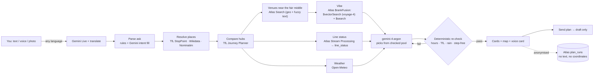

# So where?

**Tell it where you both are; it finds the fair middle in London and a place that's actually open, then checks its own pick.**

Live: **https://so-where.vercel.app** · try it with no setup: [`?demo=meet`](https://so-where.vercel.app/?demo=meet)

> The base map and chat existed before Encode kickoff; features listed as Encode-built were made during the hackathon.

---

## The problem

"Where shall we meet?" takes a dozen messages in London. One of you is at Old Street, the other is in Brixton. Picking "somewhere in the middle" by eye ignores how the Tube actually runs. Search results don't tell you whether a place is open at 7 on Friday, whether a line is down, or whether it will rain on the terrace. Most apps also want your friend's exact location, and some invent star ratings and "busy now" bars.

## What it does

| Feature | |
|---|---|
| **Right now in London (first screen).** Before you type, `/api/now` shows live line status (from the Atlas Stream Processing rows, or TfL directly if they are stale), this hour's weather (Open-Meteo) and today's listed events, each with its source and as-of time. Example pins and a one-tap *Meet halfway* card show what it does | Encode-built |
| **Fair middle.** Compares central hubs by real TfL journey time for both of you and picks the fairest split ("you 20 min, them 21") | Encode-built |
| **Argon picks, then gets checked.** Gemini 4 Argon chooses from a pool that has already been checked. Its picks are re-checked against opening hours, TfL, weather and step-free access. If the top pick fails, it re-picks once. The verify row is shown on screen | Encode-built |
| **Live voice, any language.** Talk to it in Italian (or any language). It plans and answers in your language | Encode-built |
| **Spoken voice card.** A short spoken summary of the plan (it can be muted) | Encode-built |
| **Follow-ups.** "Cheaper", "quieter", "later", and compound questions like "what time do they close? and what time do you recommend?" | Encode-built |
| **Vibe match.** "A cosy quiet pub" runs MongoDB Atlas hybrid search (vector + text). Cards that matched on meaning get a *Vibe match* chip | Encode-built |
| **Live line status.** MongoDB Atlas Stream Processing pulls TfL line status every 60 s. Journeys on disrupted lines are padded and marked "rerouted" | Encode-built |
| **Snap a place or poster.** Photograph a sign, landmark or event poster and it finds the place, with an honest certainty level. Faces are blurred on your device before upload. Then tap "Meet here" | Encode-built |
| **Send plan.** Opens a draft you can copy or share. Nothing is sent automatically, and your friend's area is never included | Encode-built |
| Base map (MapLibre, OpenFreeMap tiles) and chat shell | Pre-existing |

Every fact on a card has a source and an as-of time. Anything the app couldn't check is listed under **"Couldn't check"** (for example prices, or how busy a place will be).

## How it works



The planner streams each step to the UI as NDJSON, so the "How we got here" list shows the real sources and timings live. The list is collapsed under each plan ("10 checks · 8.2 s"); tap it to open. Core code: `src/lib/plan.ts`, `src/lib/verify.ts`, `src/app/api/plan/route.ts`.

## Agents

So where? is built from three Gemini agents plus plain code that checks them.

**1. Planner agent** (`src/lib/plan.ts`, `src/lib/verify.ts`, `/api/plan`). Loop: gather → pick → verify → re-pick.
- **Tools it gathers with:** TfL (StopPoint, Journey Planner), MongoDB Atlas (Search, `$rankFusion` vibe search, `line_status` from Stream Processing), Open-Meteo weather, Wikidata/Nominatim for landmarks.
- **Pick:** gemini-4-argon chooses from the checked pool and gives a one-line reason.
- **Verify:** deterministic rules re-check the pick (hours, TfL journey, rain, step-free).
- **Re-pick:** if the top pick fails, the failures go back to Argon once. If Argon is too slow, gemini-3-flash-preview picks instead, and the step says so.
- Gemini only fills gaps in the ask that the rules can't read (`src/lib/gemini-intent.ts`).

**2. Live voice agent** (gemini-3.8-live, `src/lib/live-config.ts`, `src/components/so-where/live-tools.ts`). A real-time voice conversation that answers in the language you speak. It acts only through six tools:
- `plan(query)`: run the planner;
- `refine(text)`: a follow-up such as "cheaper";
- `focus(index|name)`: show one place;
- `isOpen(name)` and `leaveBy(name)`: answer from the card's sourced facts;
- `draftMessage()`: opens the Send plan draft. It never sends.

**3. Translate agent** (`src/lib/translate.ts`, `/api/translate`). gemini-3.5-live-translate-preview turns speech in any language into an English ask. gemini-3.5-flash-lite translates replies and cards back, and the voice card speaks them with gemini-3.8-flash-tts.

**Built with AI coding assistants.** Francesco built the Encode features with AI coding agents (Grok Bot and Cursor-style agents) working in the repo, with him reviewing, testing and merging every change.

## Gemini models, and why each one

| Model | Used for | Where |
|---|---|---|
| **gemini-4-argon** | Planner pick + verify/re-pick loop; vision for posters and snaps | `src/lib/plan-model.ts`, `src/lib/verify.ts`, `src/lib/vision.ts`, `/api/poster`, `/api/place-snap` |
| **gemini-3.8-live** | Real-time voice conversation | `src/lib/live-config.ts`, `/api/live-token` |
| **gemini-3.5-live-translate-preview** | Speech in any language | `src/lib/translate.ts` |
| **gemini-3.5-flash-lite** (fallback gemini-3.8-flash) | Text translation of replies and cards | `src/lib/translate.ts`, `/api/translate` |
| **gemini-3.8-flash-tts** (fallbacks gemini-3.8-flash-lite-tts, gemini-2.5-flash-preview-tts) | Spoken voice card | `/api/speak` |
| gemini-3-flash-preview | Filling gaps in the parsed ask (thinking level low); also the planner fallback if Argon isn't available | `src/lib/gemini-intent.ts` |
| gemini-2.5-flash | One-line venue blurbs | `src/lib/blurb.ts` |
| **gemini-embedding-001** (768-dim) | Fallback vibe vectors if Atlas Automated Embedding is unavailable | `src/lib/mongo-vectors.ts` |

**Why Argon.** Picking a meeting place means weighing several things against each other: fairness, opening hours, the weather, the vibe and access. Argon is good at that kind of reasoning, and it explains the trade-off in one line ("confirmed open until 23:00 … though step-free access is not tagged"). We don't trust it blindly, though:

- Argon only chooses from a pool that has already been checked, and cards are only ever built from that pool.
- Every pick is re-checked by deterministic rules:
  - **Hard fails:** closed at the plan time, closes within 1 h, no TfL journey, over the time limit, outdoor-only when rain is forecast, or not step-free when you asked for step-free.
  - **Soft flags:** hours not listed, or facts that aren't tagged.
- If the top pick fails, the failures go back to Argon for one re-pick.
- Argon sees your ask with your friend's area removed, and never any coordinates.

In vision, Argon reads the sign. It also gives up to 5 vibe tags and a one-line description of only what is **visible**, with no ratings. It reports a high / medium / low certainty with a reason (`src/lib/snap-certainty.ts`).

## MongoDB Atlas: 6 features

Database `sowhere`:

| Collection | Contents |
|---|---|
| `venues` | 7,225 OSM venues from the 24 Oct snapshot |
| `events` | Luma events |
| `plan_runs` | Anonymised plan runs |
| `line_status` | Live TfL line status |
| `line_status_dlq` | Dead-letter queue for the stream |

| # | Atlas feature | What it does in the app | Code |
|---|---|---|---|
| 1 | **Atlas Search** (`venues_search`, `events_search`) | Finds venues near the fair middle with `compound` geoWithin + fuzzy text, and matches snapped sign names to venues. Falls back to `$geoNear`, then Overpass, then the snapshot | `src/lib/mongo-venues.ts`, `src/lib/place-snap.ts`, `src/lib/destination.ts` |
| 2 | **Vector Search** (`venues_vector`, filters on category / visitable / lat / lng) | Finds venues by meaning for vibe asks ("cosy, quiet") | `src/lib/mongo-vectors.ts` |
| 3 | **Hybrid `$rankFusion`** | Fuses `$vectorSearch` + `$search` (weights 1/1, with `scoreDetails`). The step reads "MongoDB Atlas hybrid search · vibe match: cosy, quiet" | `src/lib/mongo-vectors.ts` |
| 4 | **Automated Embedding** | Atlas embeds venue text and queries itself, so the app holds no embedding key for this path | `venues_vector` index (autoEmbed); `scripts/seed_vectors.mjs` |
| 5 | **Voyage AI `voyage-4`** | The embedding model behind Automated Embedding | `venues_vector` index definition |
| 6 | **Stream Processing** `tfl_line_status` (workspace SP2) | Every 60 s: cron `$source` → `$https` GET TfL line status (tube, Elizabeth line, DLR, Overground) → `$merge` into `sowhere.line_status`. The planner uses the rows only if they are fresh (<10 min) for every line it needs. Disrupted lines add +15 / +5 min, and cards say "· rerouted" | `scripts/stream-tfl-pipeline.cjs`, `scripts/stream-tfl.processor.json`, `scripts/asp-setup.sh`, `src/lib/line-status.ts` |

**Fallbacks.** The vibe step has a 1.5 s budget. If Automated Embedding isn't available, it runs an exact cosine aggregation over the gemini-embedding-001 vectors, fuses that with `$search` by reciprocal-rank fusion in the app, and then falls back to text only. `VIBE=off` turns the vibe step off. The *Vibe match* chip is shown only for venues that came from the vector search.

**Aggregations.** `/api/stats` runs a `$facet` over `plan_runs`. It reports plans by intent, top hubs, how many facts were confirmed, venue sources and eval privacy rates. A `plan_runs` record stores no query text and no coordinates, and the hub is not recorded when it is within 1 km of you. Code: `src/lib/plan-memory.ts`, `src/app/api/stats/route.ts`.

All six were checked live on production on 25 Oct (08:04–08:05 London). The steps "MongoDB Atlas Search … Searched 7,225 venues", "$rankFusion: $vectorSearch (Automated Embedding, voyage-4) + $search" and "MongoDB Atlas Stream Processing · live line status … streamed every 60 s" all appeared in a real plan.

## Data sources

- **TfL Unified API:** station list, StopPoint, Journey Planner and line status. Powered by TfL Open Data.
- **Open-Meteo:** the forecast for the plan time (CC BY 4.0).
- **OpenStreetMap:** the 24 Oct venue snapshot (stored in Atlas), with live Overpass as a fallback. Map tiles from OpenFreeMap. © OpenStreetMap contributors.
- **Wikidata, then OSM Nominatim:** turns landmark names into points (`src/lib/landmark.ts`). Wikipedia supplies the "Why here" line for landmarks.
- **Luma:** events.

## Privacy and human control

- **Never auto-sends.** "Send plan" opens a draft with *Copy text* or your device's *Share* sheet. The dialog says: "Nothing is sent from here. Their area is never included."
- **Your friend's location** is rounded to ~500 m (`roundToArea` in `src/lib/geo.ts`), is never stored, and never appears in the draft.
- **Your location** is rounded to ~100 m ("Location on · rounded to ~100 m"). Snap requests are rounded as soon as they reach the server.
- **Face blur on your device.** MediaPipe BlazeFace (or the browser's native FaceDetector) blurs faces before a photo leaves the phone (`src/lib/face-blur.ts`). A chip shows "Faces blurred · N", "No faces seen" or "Face blur unavailable on this device".
- **Photos, audio and text are never stored or logged.** "Photo isn't saved." `plan_runs` holds no query text and no coordinates.
- **No made-up data.** No ratings and no busyness or noise. "Couldn't check" lists what no source covers, for example "Prices: none of our sources lists them."

## Evals

`npm run eval` (`scripts/run_evals.ts`). Last full run (25 Oct, live TfL and Gemini): **90 / 92 pass.** `next build` and `tsc --noEmit` pass. The 2 known failures are wording checks in the eval cases, not wrong plans:

| Case | Why it fails |
|---|---|
| `refine-italian-only-matches` | Headline wording: it says "within 30 min of" where the case expects "near" |
| `snap-landmark-low-confidence` | The message now reads "Couldn't read the sign clearly", and the case still expects the old text |

## Running locally

Needs **Node 20+** and npm. The demo links below work with no keys at all.

```bash
git clone <repo> && cd so-where
npm install
cp .env.example .env.local        # fill in the values (names are listed below)
npm run dev                       # http://localhost:3000
```

With `GEMINI_API_KEY` only, live plans work: venues come from live Overpass, then the bundled OSM snapshot. To use MongoDB Atlas:

```bash
npm run seed:mongo     # loads 7,225 venues into sowhere.venues and creates the Atlas Search indexes
npm run seed:vectors   # builds embed_text and creates venues_vector (Automated Embedding, voyage-4); add --wait to wait for the indexes
npm run test:mongo     # unit tests on an in-memory MongoDB (no Atlas needed) plus one live plan
```

Live line status needs an Atlas Stream Processing workspace: run `scripts/asp-setup.sh` (see `docs/mongodb-stream.md`). Without it, the planner uses TfL journeys without the line-status padding.

Checks:

```bash
npx tsc --noEmit
npm run build
npm run eval           # live evals: needs GEMINI_API_KEY and network
```

Environment variable **names** only (see `.env.example`):

- **Needed:** `GEMINI_API_KEY`
- **For MongoDB Atlas:** `MONGODB_URI`, `MONGODB_DB` (default `sowhere`)
- **Optional:** `TFL_APP_KEY` (TfL works without a key, with lower rate limits)
- **Planner / vision:** `PLAN_MODEL`, `PLAN_ARGON`, `PLAN_PICK_THINKING`, `PLAN_VERIFY_THINKING`, `PLAN_GUARD_MS`, `VISION_MODEL`, `GEMINI_MODEL`
- **Voice / translation:** `LIVE_MODEL`, `LIVE_VOICE`, `NEXT_PUBLIC_LIVE_VOICE`, `TRANSLATE_MODEL`, `TTS`, `TTS_MODEL`
- **Blurbs / vibe:** `BLURBS`, `BLURB_MODEL`, `VIBE`, `VIBE_EMBED`, `VIBE_EMBED_MODEL`
- **Overpass:** `OVERPASS_URL`, `OVERPASS_URLS`
- **Stream Processing setup** (`scripts/asp-setup.sh`): `SP_CLUSTER_CONN`, `SP_NAME`, `SP_TFL_CONN`
- **Pre-existing base app:** `NEXT_PUBLIC_SUPABASE_URL`, `NEXT_PUBLIC_SUPABASE_ANON_KEY`

## Demo links

These work with no keys and no mic. They show canned **Example data** that is clearly labelled.

| Link | Shows |
|---|---|
| [`?demo=meet`](https://so-where.vercel.app/?demo=meet) | A meet-halfway plan (Old Street ↔ Clapham → Borough) |
| [`?demo=saturday`](https://so-where.vercel.app/?demo=saturday) | "What's on near me that I can just walk into?": three free, no-sign-up places near Old Street |
| [`?demo=repick`](https://so-where.vercel.app/?demo=repick) | The Argon verify row after a re-pick: "Repicked: The Trinity (hours not listed) → The Blue Maid" |
| [`?demo=translate`](https://so-where.vercel.app/?demo=translate) | An ask in Italian, answered in Italian (offline) |
| [`?demo=clarify`](https://so-where.vercel.app/?demo=clarify) | A live ask that is missing a place, so the app asks "Where's Sam coming from?" |
| [`?demo=place`](https://so-where.vercel.app/?demo=place) | Snap a place: found, with "Meet here" |
| [`?demo=place-landmark`](https://so-where.vercel.app/?demo=place-landmark) | Snap a landmark: University of Greenwich, with "Why here" and "Meet here" |
| [`?demo=place-candidates`](https://so-where.vercel.app/?demo=place-candidates) | Sign matches several places: "Which one?" |
| [`?demo=place-nomatch`](https://so-where.vercel.app/?demo=place-nomatch) | No match, handled honestly |

## What's next

- Sunny-terrace check: a 3D sun/shadow analysis so "sunny beer garden at 5pm" is answered with evidence, not guessed.
- The Gemini Interactions API, for longer-running, resumable planning sessions.
- Calendar: suggest times when both people are free (an `.ics` export already exists).

## Licence

MIT © 2026 Francesco Coccia
