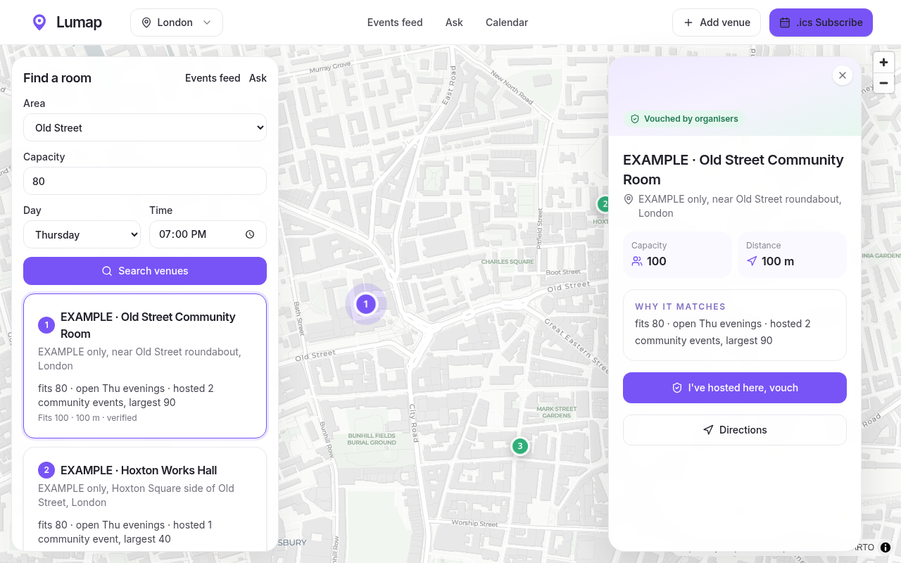

# Lumap Near Me: what's happening around you, in plain English (Encode London 2026)

**One map for a London neighbourhood, built from live open data:** TfL lines, stations and roadworks, planning applications, weather, air quality, flood alerts and Luma events. Ask questions in plain English and get answers with sources, freshness and confidence. When it suggests a place, it plans the trip with TfL (step-free options, live disruptions, walking or cycling, weather advice). Take a photo to draft a Luma event or a new map entry; nothing is published until you approve it, and every step goes in an action log.

**For:** people who just arrived in a London area (organisers, newcomers, wheelchair users) who want to know what's on, what's changing and how to get there. Plan: `knowledge/plan.md`. Pitch and demo: `knowledge/pitch.md`.

**Live demo:** [lumap-self.vercel.app](https://lumap-self.vercel.app) · Built for the **Encode London Hackathon** (23–25 Oct 2026): The Real World + Agents That Ship.

> **Disclosure:** The base map and chat existed before Encode kickoff; features listed as Encode-built were made during the hackathon. Last pre-Encode commit: `5809e2d` (tag `encode-baseline`); see `git diff encode-baseline..encode-london`.

## Status (Encode checkpoints)
- [x] CP1 Fri 18:00: check-in (idea, bounty)
- [x] CP2 Sat 18:00: progress (demo link, repo, problem). Bounties: The Real World, Agents That Ship
- [ ] CP3 Sun 12:00 GMT: final submission (3-min video, repo, bounties)

## Built at Encode (Fri 23 Oct 17:00 onwards)
- [ ] Neighbourhood briefing `/api/near`: TfL, roadworks, planning, weather, air quality, flood alerts, with source + time on every line
- [ ] Map layers for each source, next to the existing venues and Luma events
- [ ] Ask agent with tool calls (Gemini): sourced answers, confidence, "data missing" said plainly
- [ ] Get there: TfL Journey Planner with step-free options, disruptions and weather advice
- [ ] Photo intake: EXIF GPS read then stripped, faces blurred in the browser, photo read with confidence
- [ ] Photo → Luma event (approve first) · Photo → OpenStreetMap note + Google Maps "Add a missing place" link (approve first)
- [ ] Action log of every tool call and approval
- [x] General polish on Fri evening (sign-in, date picker, postcode origin, Ask fixes). Not part of the Encode feature.

## Already there before Encode
- **Find a room:** area, capacity, date and time → PostGIS search within walking distance, the best three with a reason each.
- **Map and venue panel:** MapLibre pins; click for capacity, distance, trust status, organiser details and directions.
- **Vouch-based trust:** venues and reports need vouched organisers (Supabase RLS, a shared review queue, a 2-vouch trigger).
- **Ask Lumap:** text or voice (Web Speech API), answered from Cognee community memory + Grok, with sources.
- **Events feed:** `/api/calendar.ics`, a ranked London community events feed.

## Models & data sources
*(fill in as built; full table with endpoints in `knowledge/plan.md` §5)*
| Model / source | Used for |
|---|---|
| Gemini API (`gemini-3.8-flash` for Ask tool calls; `gemini-4-argon` for photo read + verification, if entered) | Ask agent, photo understanding |
| TfL Unified API (Journey, Line status, StopPoint, Road disruptions) | journeys, step-free stations, disruptions, roadworks |
| Planning London Datahub | planning applications near a point |
| Open-Meteo | hourly weather |
| LAQN (Imperial College London) | air quality index |
| Environment Agency flood monitoring | flood alerts |
| Luma (seed snapshot; public API for event creation with Luma Plus) | events, "create an event here" |
| OpenStreetMap Notes API | "add this place" notes |
| xAI Grok + Cognee Cloud | existing Ask answers |
| postcodes.io | origin geocoding |
| MongoDB Atlas (if used) | source snapshots, action log, hybrid search |

Attribution: Powered by TfL Open Data · Planning London Datahub (GLA) · Open-Meteo · LAQN · Environment Agency (OGL v3) · © OpenStreetMap contributors.

## Responsibility
- Photos: GPS is read in the browser and then stripped with all EXIF; faces (and plates, when detected) are blurred before anything is published. Raw photos are not stored.
- No personal location is stored; logs keep a rounded location only.
- Every answer shows its sources and how fresh they are; missing or unclear data is said plainly, never guessed.
- The agent never publishes without approval (Luma, OSM), and every action is logged.

## Stack

- Next.js 15 (App Router) and TypeScript
- Tailwind CSS v4, shadcn/ui, Motion and lucide-react, with a light theme
- MapLibre GL 4 with CARTO Positron tiles
- Supabase Postgres with PostGIS and row-level security
- Cognee Cloud for community memory, plus an xAI (Grok) LLM
- Deployed on Vercel

## Vouch trust model

The city starts with a small set of trusted root organisers. An approved organiser can vouch for another, and only vouched organisers can add or edit venue records. Row-level security in Supabase enforces this (`supabase/policies.sql`). Venues need two vouches before they appear publicly, unvouched users never see venue contact details, and revoking a vouch hides that organiser's edits again.

## Data

The old **EXAMPLE** venues have been removed. Venue types, hours and capacity come only from public pages (venue websites, Luma, listing sites), with every source URL kept in `src/data/venue-facts.json`. Recurring sessions such as Co-Working Fridays at Somerset House are in `src/data/recurring-sessions.json`. No venue contact details are published, and the events feed comes from public event listings (`seed/`). The three trust roots in `config/city.json` are still placeholder accounts.

## Run it locally

1. Copy `.env.example` to `.env` and fill in the values below.
2. In the Supabase SQL editor, run `supabase/schema.sql`, `supabase/policies.sql`, `supabase/search.sql` and `supabase/seed.sql`, in that order.
3. Optionally, load community memory with `python scripts/cognee_load.py`.
4. Run `npm install` and then `npm run dev`, and open http://localhost:3000.

### Environment variables

Never commit real values.

- `NEXT_PUBLIC_SUPABASE_URL`, `NEXT_PUBLIC_SUPABASE_ANON_KEY`: the browser search client
- `SUPABASE_URL`, `SUPABASE_ANON_KEY`: server routes
- `SUPABASE_SERVICE_ROLE_KEY`: seeding only; keep it off the server and out of Vercel
- `LLM_API_KEY`: xAI (Grok)
- `COGNEE_API_KEY`, `COGNEE_BASE_URL`, `COGNEE_TENANT_ID`
- `COGNEE_DATASET`: optional; defaults to `lumap_london`

## Fork it for another city

`config/city.json` holds the city name, slug, map centre and trusted root organisers. To start a fork, edit that file, replace the London seeds in `seed/` and `supabase/seed.sql`, add your root organisers, and apply the Supabase schema and policies.

## Licence

[MIT](LICENSE) © 2026 Francesco Coccia

## Provenance
The base map and chat existed before Encode kickoff (copied from github.com/francescococcia/lumap, branch encode-london at 3937a6e); features listed as Encode-built were made during the hackathon.

